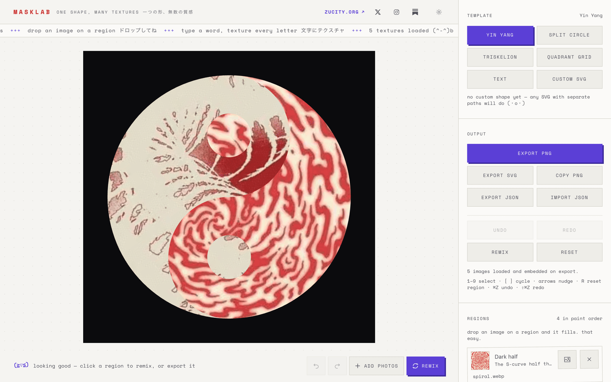
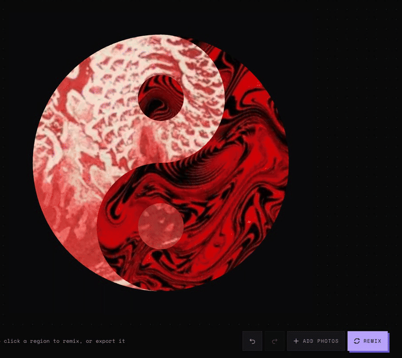
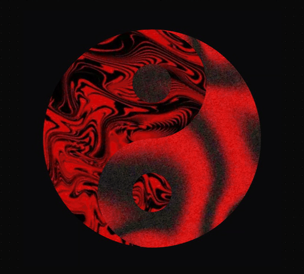
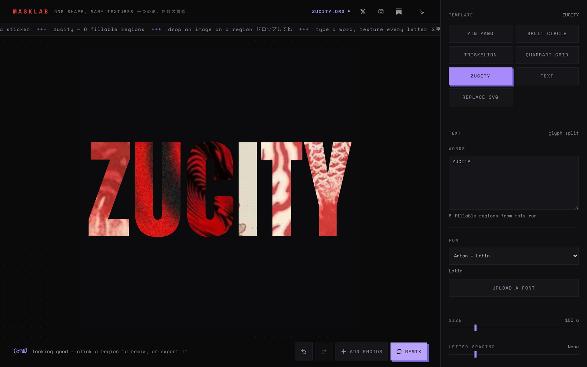
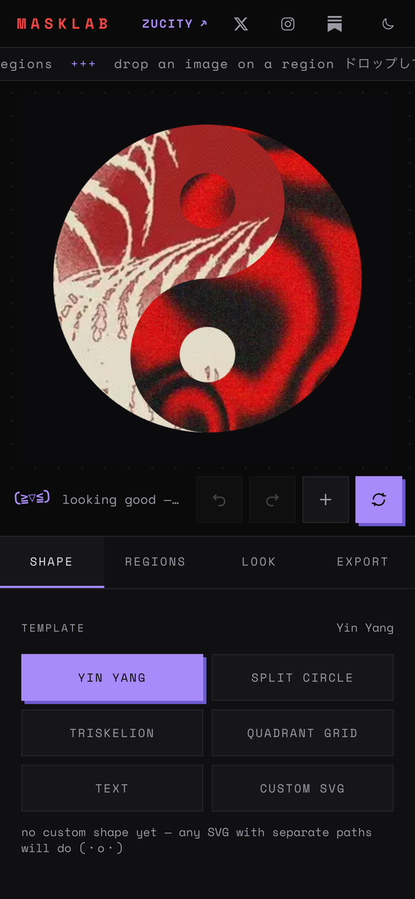
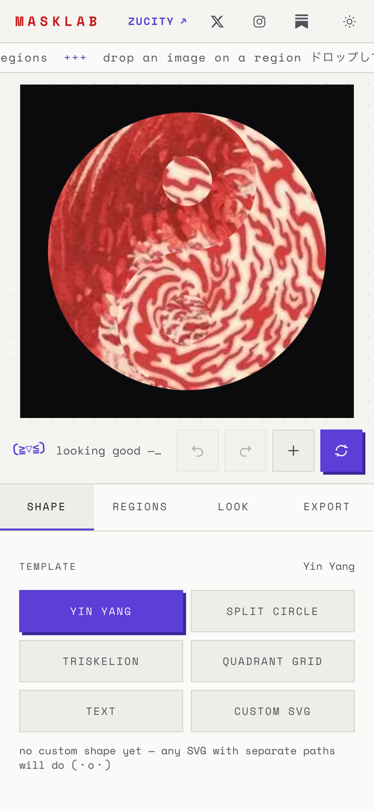
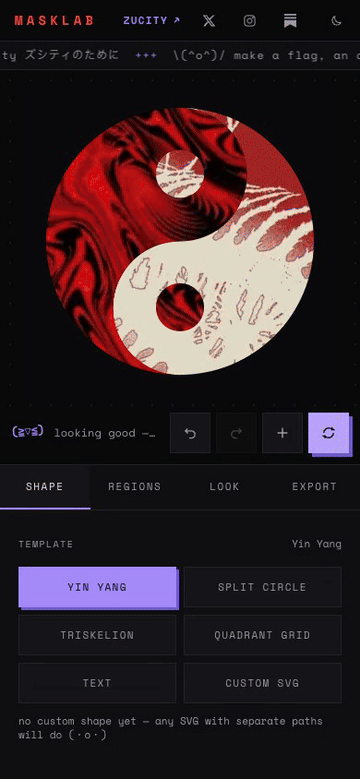
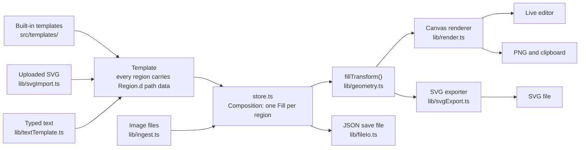

<!-- markdownlint-disable MD033 MD041 MD013 -->
<div align="center">

# 🎭 MaskLab

**One shape. Many textures.**

Put a different image in each part of a shape, or in each letter of a word you type. Then export it as PNG, SVG or a save file. It all runs in your browser.

[](LICENSE)
[](https://zucity-aesthetics.vercel.app)
[](https://react.dev/)
[](https://www.typescriptlang.org/)
[](https://vite.dev/)
[](https://pnpm.io/)
[](#-contributing)

[**Try it**](https://zucity-aesthetics.vercel.app) · [Quick start](#-quick-start) · [Guide](https://zucity-aesthetics.vercel.app/guide.html) · [For agents](#-for-ai-agents)

<picture>
  <source media="(prefers-color-scheme: dark)" srcset="docs/media/hero-dark.png">
  
</picture>

</div>

---

## 🤔 Why this exists

A yin-yang saved as one SVG path is one shape. You can't put one photo in the black half and another in the white half, because the halves can't be selected on their own. MaskLab splits a shape into regions you can fill one by one, and does the same for typed letters. It was made for [ZuCity](https://zucity.org), a coliving neighborhood an hour from Tokyo in the Japanese Alps, for flags, stickers and album covers.

## 🚀 Quick start

### 🎨 For users

1. Open **[zucity-aesthetics.vercel.app](https://zucity-aesthetics.vercel.app)**. The canvas opens already filled with two starter textures.
2. Press **Add photos** (the **+** under the canvas) and pick a few images. They are dealt into the shape. Press **Remix** to deal again.
3. Open **Output** (the **Export** tab on a phone) and press **Export PNG**.

Nothing is uploaded. Your images and fonts stay on your device. There is no autosave, so press **Export JSON** if you want to reopen a look later. The full walkthrough is in [docs/how-to-use.md](docs/how-to-use.md).

<details>
<summary><strong>Gestures and keyboard shortcuts</strong></summary>

| Gesture | Effect |
| --- | --- |
| Click or tap a region | Selects it (no undo step) |
| Drag on the canvas | Moves the selected texture |
| Scroll / Shift-scroll | Zooms / spins the selected texture |
| Two-finger pinch and twist | Zooms and spins the selected texture (touch) |
| Drop a file on a region | Fills that region |
| Paste (`⌘V` / `Ctrl+V`) | Adds an image from the clipboard |

| Key | Action |
| --- | --- |
| `1`–`9` | Select region N in paint order |
| `[` `]` | Previous / next region |
| Arrows | Nudge the texture (`Shift` for 5×) |
| `r` | Reset the selected region |
| `⌘Z` / `Ctrl+Z` | Undo (30 steps) |
| `⇧⌘Z` / `Ctrl+Shift+Z` / `Ctrl+Y` | Redo |

</details>

### 💻 For developers

```bash
pnpm install
pnpm dev        # http://localhost:5173
```

No environment variables, no backend. More in [Developer setup](#️-developer-setup).

## ✨ What you can do

| | Feature | What it does |
| --- | --- | --- |
| ☯️ | **Built-in shapes** | Yin Yang (4 regions), Split Circle (2), Triskelion (6), Quadrant Grid (4). Switching shape keeps your textures. |
| 📐 | **Your own SVG** | Upload an SVG. Every `path`, `circle`, `ellipse`, `rect`, `polygon` and `polyline` becomes a region. |
| 🔤 | **Typed text** | Type a word and each glyph becomes its own region, with real outlines. Split by glyph, line or the whole run. Four bundled fonts, or upload a `.ttf` / `.otf` / `.woff`. |
| 🗾 | **Vertical Japanese** | Set the direction to Vertical: glyphs stack down, columns run right to left, each glyph still its own region. |
| 🖼️ | **Per-region textures** | Each region gets its own image or colour, with drag, zoom, spin, offset, flip, opacity and blend mode. |
| 🎲 | **Remix** | Deals your loaded images across the regions again with fresh placement. Every image gets a turn before any repeats. |
| ↩️ | **Undo and redo** | 30 steps. One drag, pinch or held arrow key is one step. Selecting a region costs nothing. |
| 📤 | **Four exports** | PNG up to 4096 px, a real vector SVG with one clip path per region, a JSON save file with images embedded, and copy to clipboard. |
| 🌗 | **Light, dark or system theme** | A header button cycles System → Light → Dark and remembers your choice. |
| 📱 | **Built for phones** | On a phone the controls become four tabs (Shape, Regions, Look, Export) under a pinned canvas. Installable to the home screen. |
| 🌱 | **Starter textures** | Five bundled ZuCity textures. Each visit opens on a different pair. |
| 🔒 | **Private by design** | Everything runs in the browser. No account, no server, no upload. |
| 📖 | **A plain guide** | [`/guide.html`](https://zucity-aesthetics.vercel.app/guide.html) answers eight common questions in static HTML that needs no JavaScript, written for people and answer engines. |
| ⚡ | **Fast** | Measured with a real 4× CPU slowdown, a phone load blocks the page for about 28 ms. Lighthouse mobile: 92–99 performance, 100 accessibility, 100 best practices, 100 SEO. |

### 🎲 Add photos, then Remix



### 🖐️ Move, zoom and spin a texture inside its region



### 🔤 Text mode



### 📱 On a phone

<table>
  <tr>
    <td align="center"></td>
    <td align="center"></td>
    <td align="center"></td>
  </tr>
  <tr>
    <td align="center">Dark</td>
    <td align="center">Light</td>
    <td align="center">In use</td>
  </tr>
</table>

▶️ [Watch the 24-second walkthrough (MP4)](docs/media/demo.mp4)

## ⚙️ How it works



Every shape source, including text, is turned into SVG path data (`Region.d`) before it reaches the renderer, so nothing downstream needs special cases. The canvas and the SVG exporter both get texture placement from one function, `fillTransform()`, so the PNG and the SVG match by construction instead of by checking. The live editor and the PNG export also share one draw function, so what you see is what you download. The one known difference is film grain: the PNG uses a noise tile and the SVG uses an SVG filter. Details in [docs/architecture.md](docs/architecture.md).

## 🗂️ Project structure

```text
index.html            Meta tags, JSON-LD, crawlable fallback HTML, theme boot script
src/
  App.tsx             Layout, header links, phone tabs, first-visit starter look
  store.ts            Zustand state, 30-step undo/redo, the history contract
  types.ts            Data model: Region, Template, Fill, Asset, Composition
  lib/                geometry (fillTransform), render, svgExport, pngExport,
                      fileIo, ingest, svgImport, textTemplate, imageCache
  templates/          One file per built-in shape, plus the registry
  components/         Stage (canvas), Inspector, TextPanel (lazy), RegionCard, …
  hooks/              Keyboard shortcuts
public/
  fonts/              Bundled OFL fonts + LICENSE.txt
  textures/           Five starter textures (WebP)
  guide.html          Static answer page at /guide.html
scripts/indexnow.mjs  IndexNow ping, run after each production deploy
docs/                 How to use, architecture, SEO, media for this README
```

The full file map is in [AGENTS.md](AGENTS.md#file-map).

## 🛠️ Developer setup

<details>
<summary><strong>Commands, checks, speed and deploy</strong></summary>

### Run it

```bash
pnpm install
pnpm dev        # Vite dev server
pnpm build      # tsc -b && vite build -> dist/
pnpm preview    # serve the production build
```

### Check a change

```bash
pnpm exec tsc -b --noEmit   # types
pnpm build                  # types + bundle
pnpm exec oxlint src        # lint
```

There is **no test suite**. Verify a change by driving the app in a browser. In a dev build, `window.__masklab` is the Zustand store, so you can drive and inspect the app from the console:

```js
window.__masklab.getState().setTemplate('triskelion');
```

### Measure speed

Use the real-throttle checker, not your eye:

```bash
node ~/Developer/jitsu-os/scripts/real-perf.mjs https://zucity-aesthetics.vercel.app/
```

It applies a real 4× CPU slowdown in a fresh Chrome per run, checks that the slowdown took effect, and fails on blocking over 200 ms, a freeze over 300 ms, any same-origin 404 or any failed font.

### Deploy

```bash
pnpm dlx vercel --prod --scope xjitsu
node scripts/indexnow.mjs   # tell IndexNow engines about the app and the guide
```

The build is a fully static `dist/`. `vercel.json` sets cache headers only. See [docs/seo.md](docs/seo.md) for what to do after a deploy.

</details>

## 🤖 For AI agents

Start with **[AGENTS.md](AGENTS.md)**. It lists the invariants, task recipes (add a template, an export, a control, a font) and the full file map. Then use the [docs](#-docs) as needed.

Hard rules. Breaking any of these fails silently:

1. **`fillTransform()` in `src/lib/geometry.ts` is the only place texture placement is computed.** Both renderers read it. Never recompute the cover maths, and never fork `renderComposition()` into editor and export versions.
2. **`Region.d` (SVG path data) is the only shape interface.** A new shape source must turn itself into path data. Never add a `kind` field or a text-only render path.
3. **History contract.** Continuous edits (drags, sliders, wheel) record one undo step per gesture, then use `updateFill`. Discrete edits use `commitFill`. A gesture that changes nothing records nothing.
4. **Never import `TextPanel` or `lib/textTemplate` statically** from an eagerly loaded module. They stay lazy to keep the typesetter out of the main bundle.
5. **No `llms.txt`, on purpose.** No crawler reads it. Agent-readiness comes from AGENTS.md, accessible HTML, JSON-LD and the crawlable fallback in `index.html`.
6. **There is no test suite.** Don't claim tests pass. Run the checks above and drive the app.

## 📚 Docs

| Doc | What's in it |
| --- | --- |
| [docs/how-to-use.md](docs/how-to-use.md) | Every feature, step by step, for users |
| [docs/architecture.md](docs/architecture.md) | How it's built and why: data flow, PNG/SVG parity, caching |
| [docs/seo.md](docs/seo.md) | Search and AI visibility, the guide page, rules for changing site copy |
| [Guide page](https://zucity-aesthetics.vercel.app/guide.html) | Eight common questions with short answers |
| [AGENTS.md](AGENTS.md) | Invariants, recipes and file map for contributors and agents |
| [CHANGELOG.md](CHANGELOG.md) | What changed, by date |

## 🧰 Tech stack

| Layer | Choice |
| --- | --- |
| Build | [](https://vite.dev/) |
| UI | [](https://react.dev/) [](https://www.typescriptlang.org/) |
| Styling | [](https://tailwindcss.com/) |
| State | [](https://zustand.docs.pmnd.rs/) |
| Type outlines | [](https://github.com/opentypejs/opentype.js) |
| Rendering | Canvas 2D `Path2D` + `clip()`, and hand-built SVG. No canvas library. |
| Lint | [](https://oxc.rs/docs/guide/usage/linter.html) |
| Package manager | [](https://pnpm.io/) |
| Hosting | [](https://vercel.com/) (static) |
| Backend | None |

## 🤝 Contributing

Issues and PRs are welcome. PRs target the `test` branch first, not `main`. Read [AGENTS.md](AGENTS.md) first, run the checks in [Developer setup](#️-developer-setup), and drive the change in a browser.

**Contributor License Agreement.** By contributing to MaskLab you grant the maintainer a perpetual, worldwide, irrevocable, royalty-free licence to use, reproduce, modify, distribute, sublicense and **relicense** your contribution, including under commercial or proprietary terms, without further permission or payment. You confirm you have the right to grant this. This keeps the dual-licence model possible.

## 📄 License

[](LICENSE)
[](public/fonts/LICENSE.txt)

MaskLab's source code is licensed under the **GNU AGPL v3**. See [LICENSE](LICENSE). To ship MaskLab inside a proprietary product, or run a modified version as a network service without publishing your changes, a commercial licence is available. Open an issue to ask.

**The bundled fonts are not covered by the AGPL.** The typefaces in `public/fonts/` are third-party works under the **SIL Open Font License 1.1**, and redistributing this repository redistributes them:

| File | Typeface | Copyright |
| --- | --- | --- |
| `Anton-Regular.ttf` | Anton | © 2020 The Anton Project Authors |
| `ArchivoBlack-Regular.ttf` | Archivo Black | © 2017 The Archivo Black Project Authors |
| `ZenKakuGothicNew-Black.ttf` | Zen Kaku Gothic New | © 2022 The Zen Project Authors |
| `SpaceMono-Regular.ttf`, `SpaceMono-Bold.ttf`, and `woff2` copies of both | Space Mono | © 2016 The Space Mono Project Authors |

The OFL allows redistribution, bundling and embedding, including in a commercial product, as long as the fonts are not sold on their own and the licence and copyright notices travel with them. It does **not** let you relicense the font files. Keep [`public/fonts/LICENSE.txt`](public/fonts/LICENSE.txt) with them. Full terms: [scripts.sil.org/OFL](https://scripts.sil.org/OFL). If you fork MaskLab, this obligation forks with you.

---

<div align="center">

**One shape. Many textures.**

[**🎨 Try MaskLab**](https://zucity-aesthetics.vercel.app)

[Report a bug](https://github.com/0xjitsu/zucity_aesthetics/issues/new) · [Request a feature](https://github.com/0xjitsu/zucity_aesthetics/issues/new)

Made for **[ZuCity](https://zucity.org)** · [X](https://x.com/zucity_japan) · [Instagram](https://instagram.com/zucity_japan) · [Substack](https://jpy2.substack.com)

</div>
